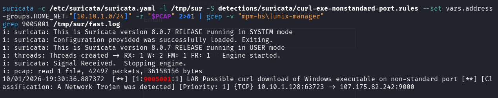

# Detections

These are draft rules based on behaviour I saw in this capture. They show how the findings could become detections, and they aren't ready to deploy as they are.

## Test status

- Suricata rule: it passed `suricata -T` on Suricata 7.0.3, and I replayed it against a small synthetic pcap (`suricata/test/make_test_pcap.py`). It alerted once, on a curl request for an `.exe` to port 9000. It stayed quiet on three negative cases: the same request on port 80, an `.exe` request with a browser User-Agent, and a curl request for a `.txt` file. I have not run it against live traffic.
  - I also ran it on Kali with Suricata 8.0.7 against the real exercise pcap (42,497 packets). It alerted once, at 19:30:36 UTC, for 10.10.1.128:63723 to 107.175.82[.]242:9000, which is the executable download (stream 128, frame 23091). Nothing else in the capture matched.


- Sigma rule: pySigma parsed it without errors. I haven't converted it for a backend or run it against real proxy logs.

| File | Format | Detects |
|---|---|---|
| `suricata/curl-exe-nonstandard-port.rules` | Suricata (tested on synthetic traffic) | HTTP GET for `.exe` with a `curl/` User-Agent from the home network to a non-HTTP port |
| `sigma/proxy_curl_exe_download_nonstandard_port.yml` | Sigma (proxy logs) | The same pattern in proxy logs, excluding ports 80 and 443 |

## Testing the Suricata rule

Synthetic test:

```bash
cd detections/suricata/test && pip install scapy && python3 make_test_pcap.py
suricata -T -c /etc/suricata/suricata.yaml -S ../curl-exe-nonstandard-port.rules --set vars.address-groups.HOME_NET="[10.10.1.0/24]"
mkdir -p out && suricata -c /etc/suricata/suricata.yaml -S ../curl-exe-nonstandard-port.rules --set vars.address-groups.HOME_NET="[10.10.1.0/24]" -r test.pcap -l out
grep 9005001 out/fast.log      # expect exactly one alert, for 10.10.1.128:63723 -> 107.175.82.242:9000
```

To test against the real exercise pcap, replace `test.pcap` with `pcaps/2026-10-01-traffic-analysis-exercise.pcap`. Expect one hit, on the request to 107.175.82[.]242:9000 (frame 23091). That is what I got. If you run Suricata as a normal user, add `-l /tmp/sur` (or any folder you own), because it can't write to `/var/log/suricata/`.

## Converting the Sigma rule

```bash
pip install sigma-cli
sigma check detections/sigma/proxy_curl_exe_download_nonstandard_port.yml
```

After that, convert it with the pipeline for your backend. The field names follow the Sigma proxy log source (`cs-method`, `c-useragent`, `c-uri`).

## Ideas I haven't turned into rules

- Outbound TCP 443 where the first client payload isn't a TLS record. This needs protocol-aware inspection such as Zeek or an `app-layer-protocol` check, plus testing on real traffic.
- A single external session that lasts longer than a set time and has a very lopsided inbound byte count.
- TLS to public DNS-over-HTTPS resolvers from hosts where that isn't expected.

## Known weaknesses

- The curl User-Agent is trivial to change.
- Legitimate use of curl on custom ports will cause false positives. Tune with allow-lists for known internal servers.
