# Incident report: network-intrusion-analysis-natureforce

| | |
|---|---|
| Capture | `2026-10-01-traffic-analysis-exercise.pcap` |
| Source | Malware-Traffic-Analysis.net, traffic analysis exercise "Natureforce" |
| Tools | Wireshark 4.6.6, tshark, capinfos, VirusTotal (hash and IP search only, no uploads) |
| Conventions | IPs and domains are defanged with `[.]`. Times are UTC. I give frame numbers so every claim can be checked against the capture. |

---

## 1. Summary

On 2026-10-01 at 19:30 UTC, the Windows workstation DESKTOP-4VGYQX7 (10.10.1.128, user `NATUREFORCE\bdiaz`) downloaded a 1,646,592 byte 64-bit Windows executable, `runner_ilove.exe`, from 107.175.82[.]242. It used curl over HTTP on TCP port 9000. 45 of 70 VirusTotal engines flag the file as malicious.

About 5.7 seconds after the download finished, the host opened a single TCP session to 195.63.128[.]106:443. The session carried about 14 MB, 97% of it toward the victim, and was still open 37 minutes later when the capture ended. It doesn't begin with a TLS handshake.

The capture doesn't show what the executable did on the host. I link the executable to the long session only through timing and adjacent source ports, not through any process-level evidence.

---

## 2. Scope and environment

| Item | Value |
|---|---|
| Packets | 42,497 |
| Capture window | 2026-10-01 19:27:27.354882 to 20:07:58.978031 (2,431.6 s) |
| SHA-256 (pcap) | `287d6dee90cfef71f98a97c42e30444608de2cf59d2f7392a0a6df8dbbc8274b` |
| SHA-256 (zip) | `ffc811c2d1e990ee6e008caf2df926ecb9e3aeed3dd0032e6e03ed085a6647bc` |
| LAN | 10.10.1.0/24 |
| Domain | natureforce[.]com (AD environment NATUREFORCE) |
| Domain controller | 10.10.1.10 (WIN-LEKBU2OY51N), also the DHCP and DNS server |
| Gateway | 10.10.1.1 |

The exercise came with two alerts:

- 107.175.82[.]242:9000: Windows executable sent from an IP address over an unusual TCP port
- 195.64.128[.]106:443: CNCmachineRMS RAT command-and-control traffic

How I handled the files:

- I worked in a Kali Linux virtual machine.
- I only hashed the extracted executable and ran `file` on it. I never executed it.
- I queried VirusTotal by hash and by IP address and uploaded nothing.
- The pcap and the executable are not in this repository.

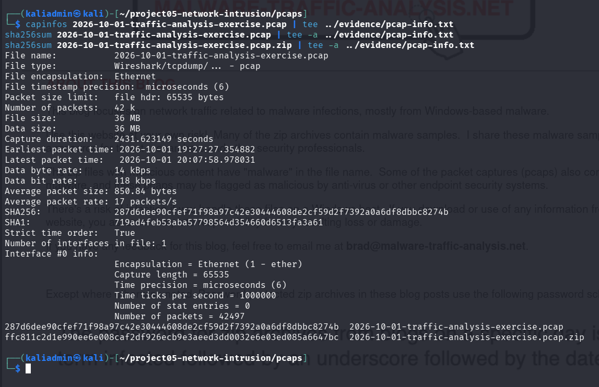

---

## 3. Answers to the exercise questions

| Question | Answer | Evidence |
|---|---|---|
| IP address of the infected client | 10.10.1.128 | DHCP Offer and ACK "Your (client) IP address" (frames 2, 4); the client requests it in Option 50 (frame 3); the same host requests the executable (frame 23091) |
| MAC address | 00:22:fb:ec:7e:e7 | DHCP "Client MAC address" (frames 2, 4); Ethernet source in frames 1 and 23088 |
| Host name | DESKTOP-4VGYQX7 | DHCP Option 12 (frames 1 and 3); Kerberos AS-REQ `addresses` field (frame 1214); LLMNR query (frame 5) |
| User account | NATUREFORCE\bdiaz | Kerberos `CNameString` in the AS-REQ (frame 1214). The same name appears on all 11 Kerberos packets that match my filter, including frame 40417 |
| SHA-256 of the executable | `b789adce70c028a6d17be45ec34667aa95586350ee0c4057e75b138b1ad35061` | Extracted from the HTTP response in frame 24916 with Export Objects |

### 3.1 Client IP and MAC (DHCP)

The four-step DHCP exchange (Discover, Offer, Request, ACK) shares one transaction ID, `0x7a87093f`. Both the Offer and the ACK carry `Your (client) IP address: 10.10.1.128` and the client MAC address.

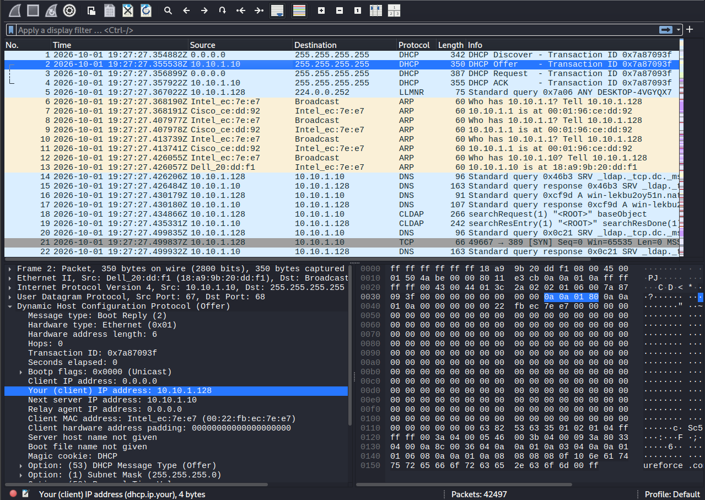
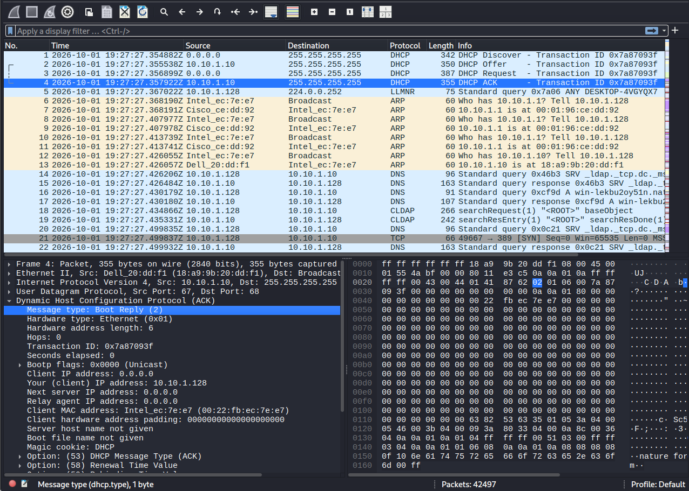

### 3.2 Host name

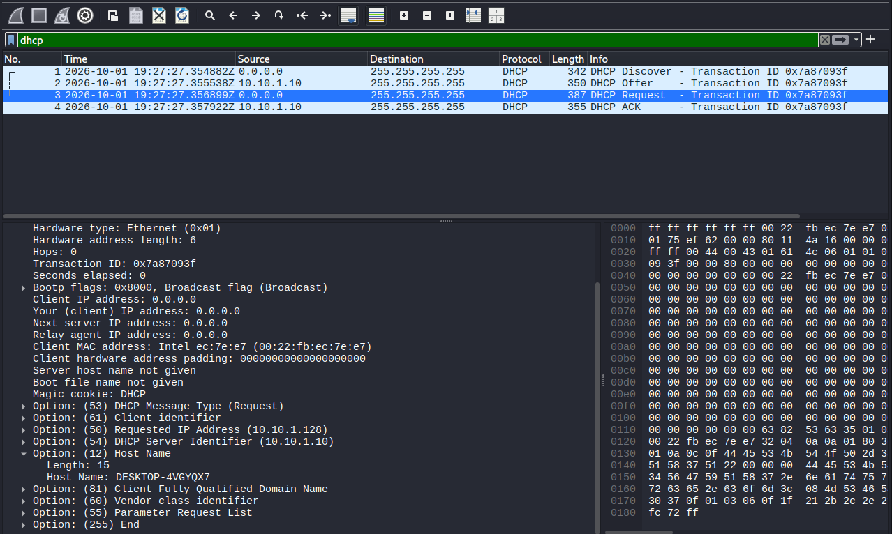

### 3.3 User account (Kerberos)

About 19 seconds after the host got its address, the first AS-REQ asks the domain controller for a ticket-granting ticket (`sname` is `krbtgt`) for `bdiaz` in the realm `NATUREFORCE`.

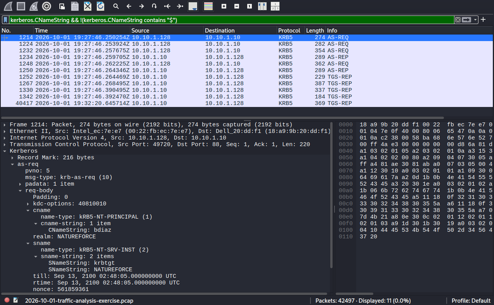
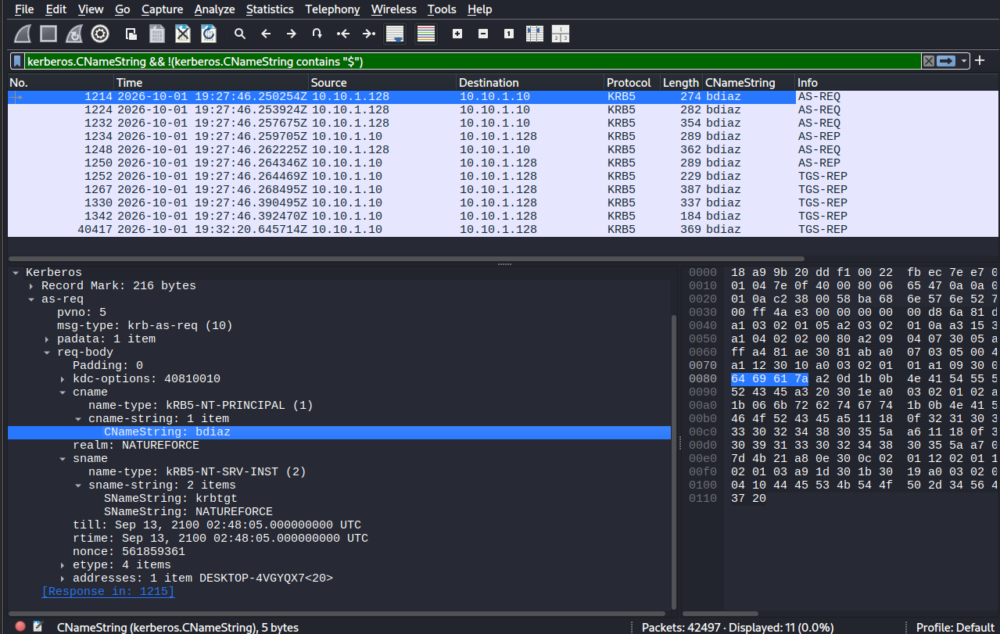

---

## 4. Timeline (UTC)

| Time | Source | Destination | Event | Evidence |
|---|---|---|---|---|
| 19:27:27.354882 | 0.0.0.0 | 255.255.255.255 | First packet in the capture: DHCP Discover | Frame 1 |
| 19:27:27.357922 | 10.10.1.10 | 10.10.1.128 | DHCP ACK, lease for 10.10.1.128 | Frame 4 |
| 19:27:46.250254 | 10.10.1.128 | 10.10.1.10 | Kerberos AS-REQ for `bdiaz` (logon) | Frame 1214 |
| 19:28:59.995986 | 10.10.1.128 | 10.10.1.10 | DNS lookup for holtandberyl[.]com, answered with 35.170.55[.]9 | Frames 8228, 8231 |
| 19:29:00.304308 | 10.10.1.128 | 35.170.55[.]9 | HTTP GET `/prw`. A second GET, `/crv`, follows at 19:29:01.737924. Each reply is a 178-byte `301 Moved Permanently` page from nginx/1.24.0 (Ubuntu), and the `Location` headers send the client to the same paths over HTTPS | Frames 8235, 8345 |
| 19:30:29.862 | 10.10.1.128 | 57.150.53[.]97:443 | 12 MB TLS session to a Microsoft Azure blob host, ending about 0.13 s before the next TCP connection starts | Stream 127 |
| 19:30:36.732236 | 10.10.1.128 | 107.175.82[.]242:9000 | TCP connection to the executable server begins | Frame 23088 |
| 19:30:36.806810 | 10.10.1.128 | 107.175.82[.]242:9000 | `GET /wilow/runner_ilove.exe`, User-Agent `curl/8.21.0` | Frame 23091 |
| 19:30:38.580040 | 107.175.82[.]242 | 10.10.1.128 | `200 OK`, 1,646,592 bytes, `binary/octet-stream` | Frame 24916 |
| 19:30:43.996091 | 10.10.1.128 | 10.10.1.10 | DNS lookup for dns[.]google | Frame 24922 |
| 19:30:44.049122 | 10.10.1.128 | 8.8.4[.]4:443 | TLS 1.3 session, SNI `dns.google` | Frames 24926, 24929 |
| 19:30:44.328983 | 10.10.1.128 | 195.63.128[.]106:443 | Only SYN to this address in the capture | Frame 24963 |
| 19:30:44.723715 | 10.10.1.128 | 195.63.128[.]106:443 | First data from the victim; not a TLS record | Frame 24969 |
| 19:32:20.645714 | 10.10.1.10 | 10.10.1.128 | Kerberos TGS-REP for `bdiaz`; LDAP, Kerberos and LDAP connections to the DC open within 30 ms (section 6.3) | Frame 40417 |
| 20:07:57.964747 | 10.10.1.128 | 195.63.128[.]106:443 | Last packet of the session, an ACK. No FIN or RST | Frame 42495 |
| 20:07:58.978031 | | | Capture ends | |

The same timeline is in [`evidence/timeline.csv`](../evidence/timeline.csv).

---

## 5. Executable download (alert 1)

When I filtered on the two alert addresses, one internal host showed up, 10.10.1.128, connecting to 107.175.82[.]242 on port 9000.

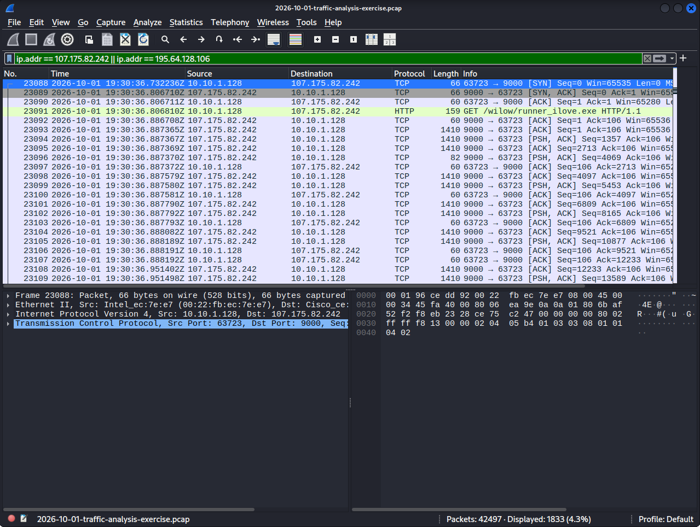

The request was made with curl, which fits a script or command-line download better than someone clicking in a browser. That only describes the tool. It doesn't show who or what started the download.

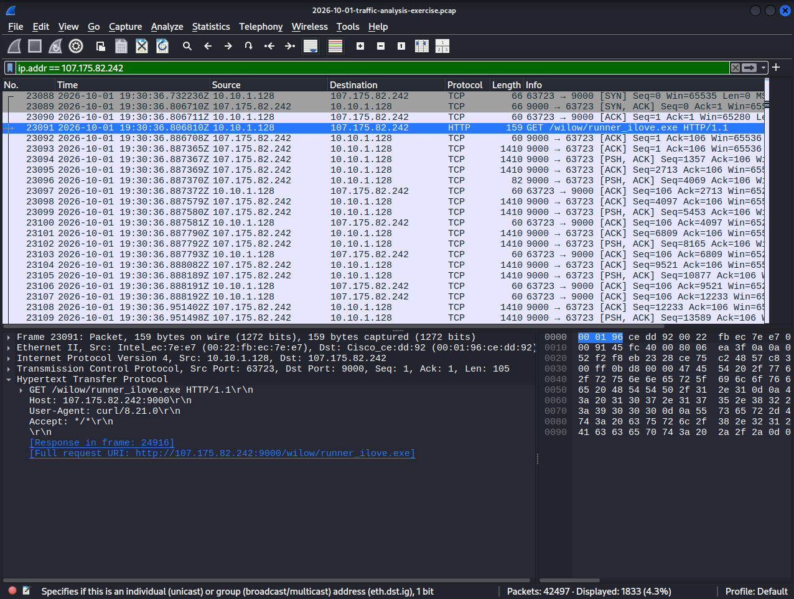

| Field | Value |
|---|---|
| Request | `GET /wilow/runner_ilove.exe HTTP/1.1` |
| Host | `107.175.82.242:9000` (an IP address, so no DNS lookup was needed) |
| User-Agent | `curl/8.21.0` |
| Response | `200 OK`, `binary/octet-stream`, Content-Length 1,646,592 |
| Server header | MinIO (an S3-compatible storage server; port 9000 is its default) |
| Last-Modified | Thu, 01 Oct 2026 18:46:36 GMT (about 44 minutes before the download) |
| Transfer | 1,833 packets, 2.14 s, closed cleanly with FIN |

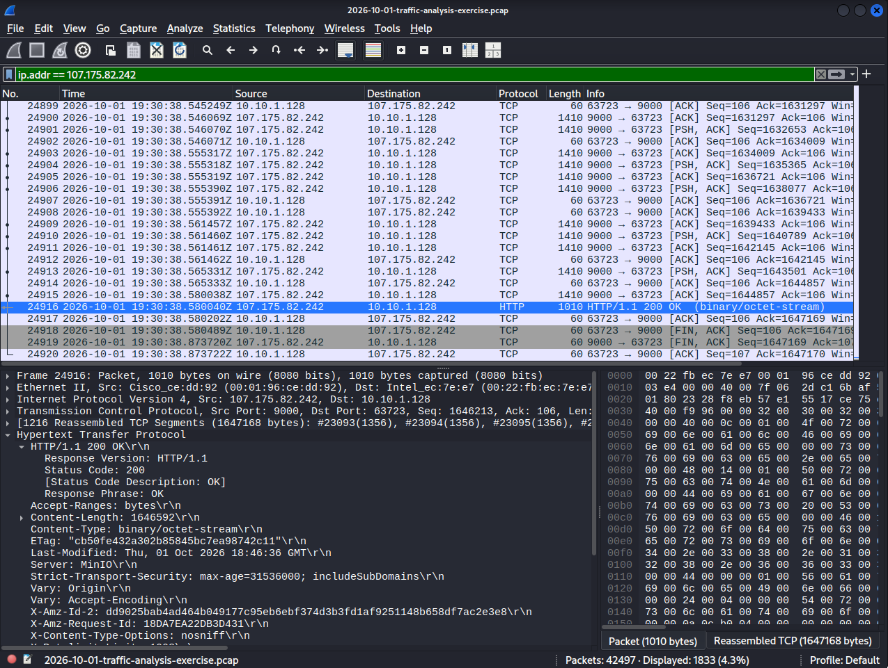
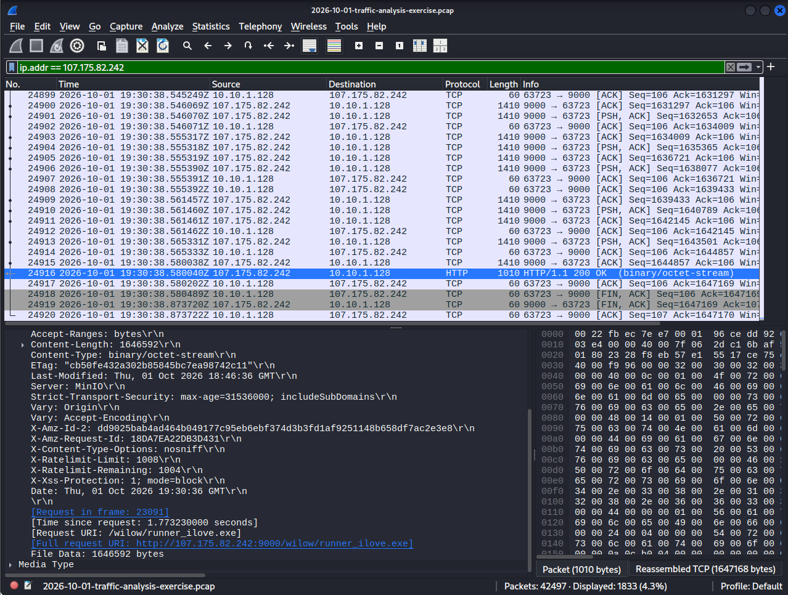

### 5.1 Extracting and verifying the file

I exported the file with File > Export Objects > HTTP (packet 24916) into a separate folder.

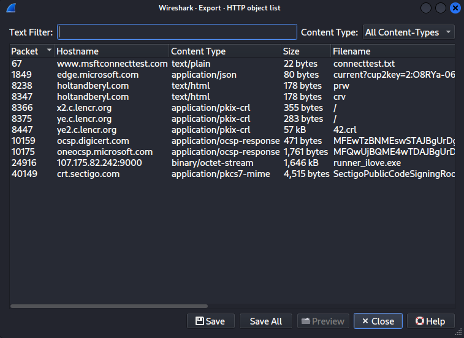

| Check | Result |
|---|---|
| Size | 1,646,592 bytes, equal to Content-Length |
| MD5 | `cb50fe432a302b85845bc7ea98742c11`, equal to the server ETag, so the extracted file matches what the server held |
| File type | PE32+ executable for MS Windows 6.00 (GUI), x86-64, 8 sections |
| SHA-256 | `b789adce70c028a6d17be45ec34667aa95586350ee0c4057e75b138b1ad35061` |

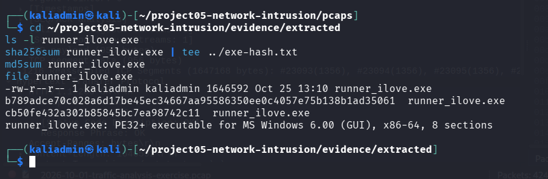

---

## 6. The session to 195.63.128[.]106 (TCP stream 130)

| Measurement | Value |
|---|---|
| Endpoints | 10.10.1.128:63725 and 195.63.128[.]106:443 |
| Start | 19:30:44.328983 |
| Last packet | 20:07:57.964747 (duration 2,233.6 s, about 37 min 14 s) |
| Packets | 15,595 (5,398 victim to server, 10,197 server to victim) |
| Bytes, server to victim | 14,013,041 (97.0%) |
| Bytes, victim to server | 434,262 |
| Connection attempts | 1 SYN in the whole capture |
| TLS Client Hello | None detected (tshark count 0) |
| First payload bytes (frame 24969) | `749c90db ffffffff 24af9c9e 43000000`, which isn't the `16 03` start of a TLS record |
| End state | Still open when the capture ended |

Byte counts are sums of frame lengths, so they include Ethernet, IP and TCP headers.

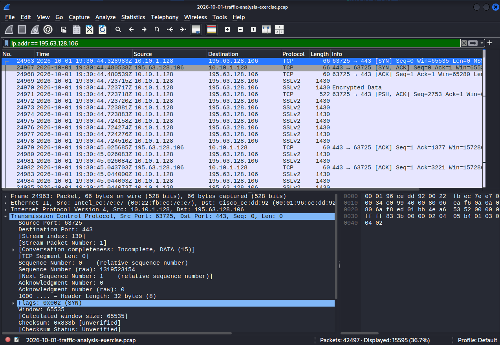
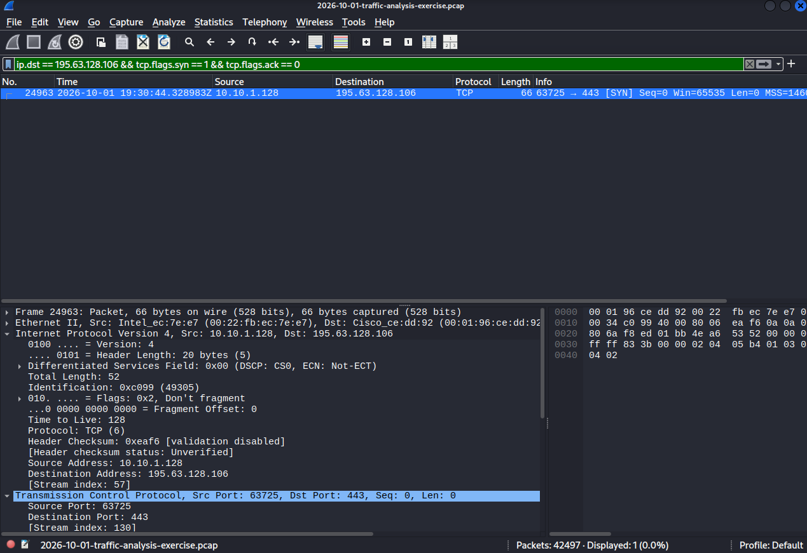
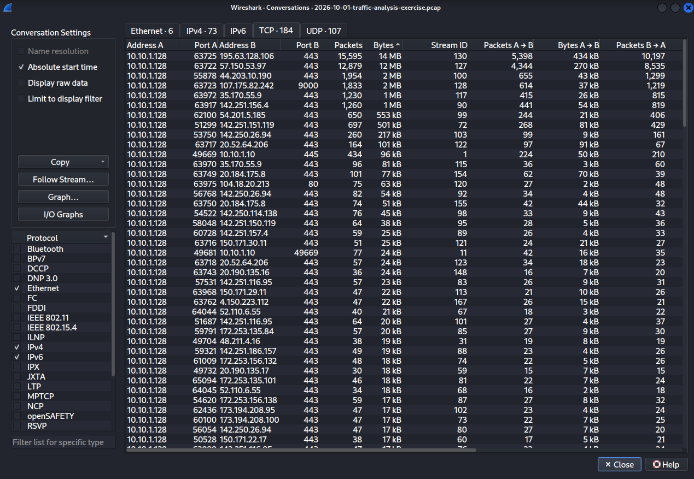
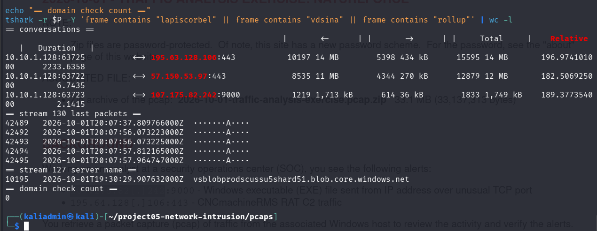
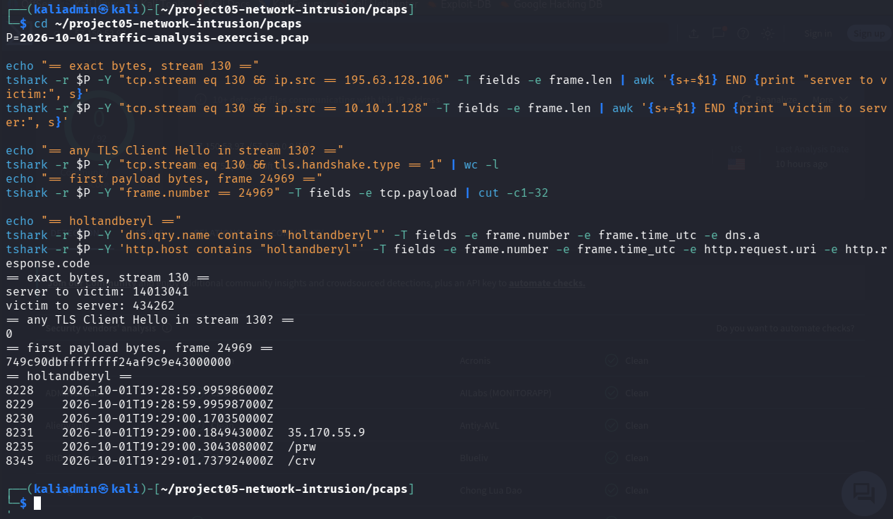

What I make of it:

- The handshake completed (frames 24963, 24967, 24968), so the server was reachable and answered.
- Traffic on port 443 that doesn't start with a TLS handshake is a protocol mismatch, and worth alerting on.
- Three connections made in sequence use source ports 63723 (the executable download), 63724 (8.8.4.4) and 63725 (this session). Consecutive ports fit one program making all three connections, but Windows hands out ports in order to any program, so this isn't proof.
- The heavy inbound direction argues against simple data theft. I can't read the stream, so I can't confirm its purpose.

### 6.1 Connections around it

The victim looked up `dns.google` at 19:30:43.996. Then, 0.05 seconds later, it opened a TLS 1.3 session to 8.8.4.4 with that server name, and 0.28 seconds after that came the session to 195.63.128[.]106. This fits encrypted DNS lookups, but the content is encrypted and a browser or the operating system can also use that service, so I can't confirm the purpose. I found no DNS query for either attacker address in the lookups I reviewed, and the executable server was addressed by IP in the URL.

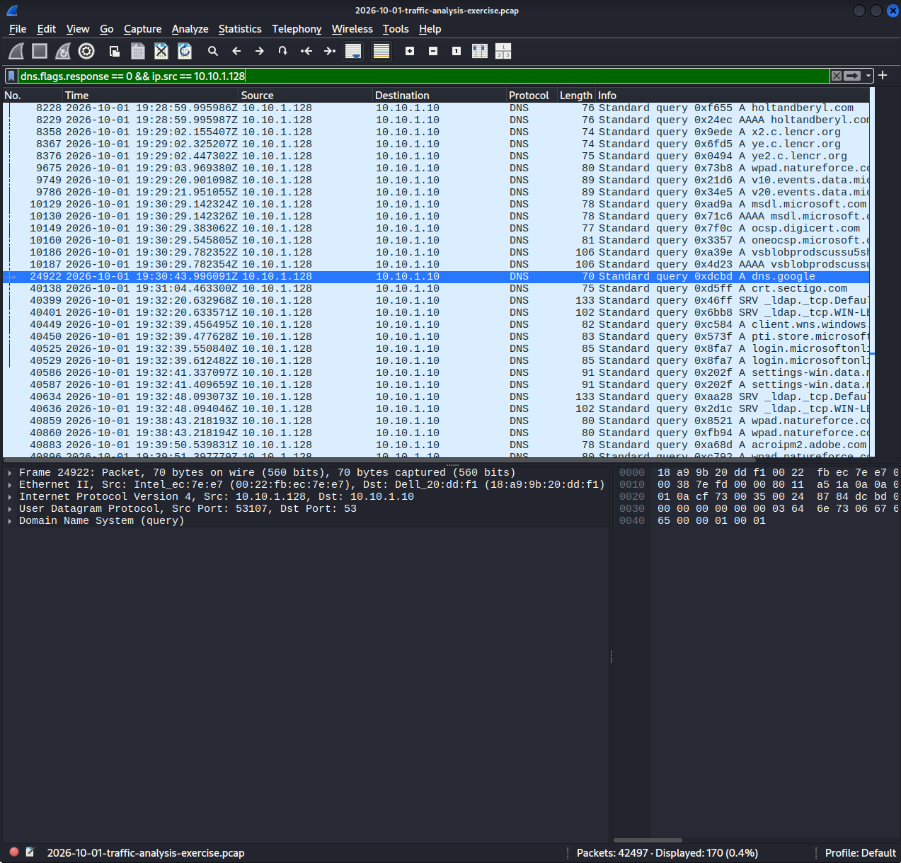
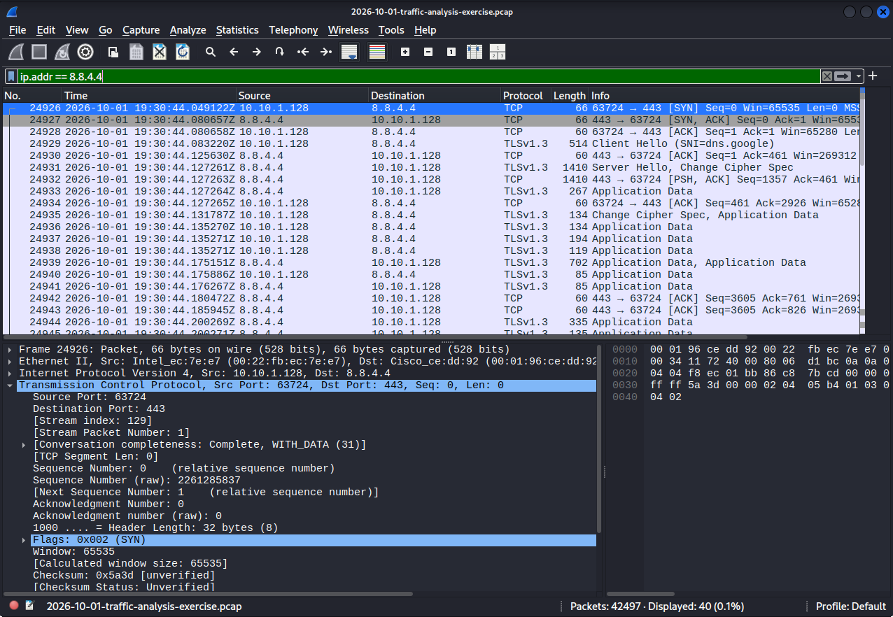
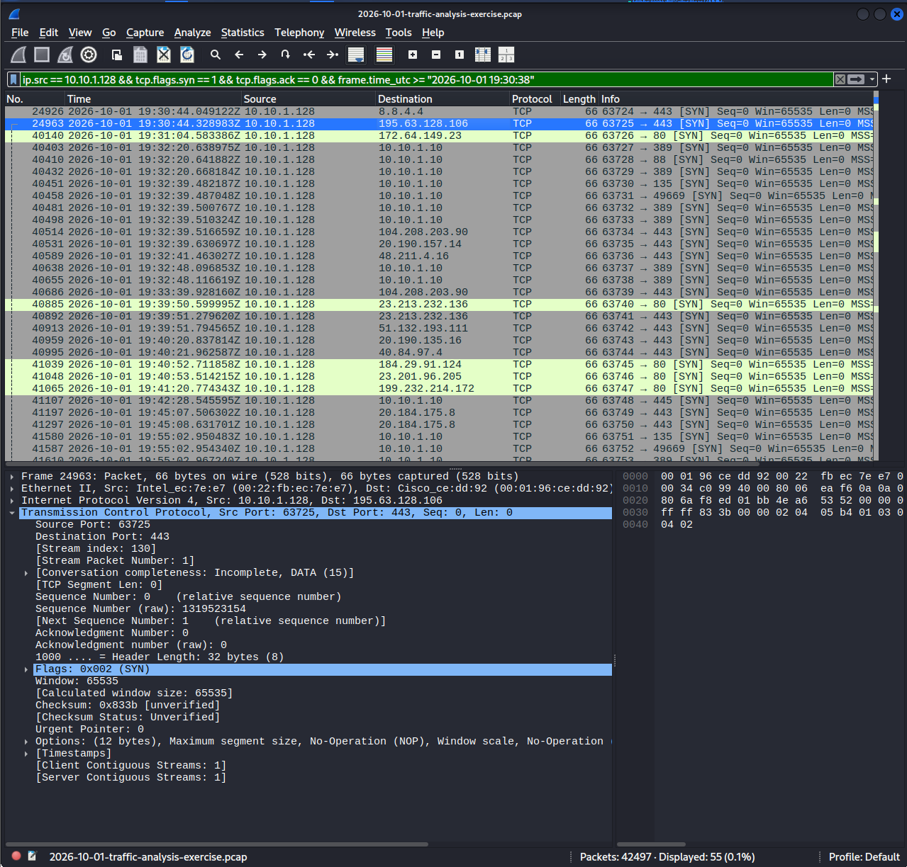

The second largest session (stream 127, 12 MB in 6.7 s to 57.150.53[.]97) finished just before the executable download began. Its TLS server name is `vsblobprodscussu5shard51.blob.core.windows.net`, and VirusTotal lists the address under Microsoft (AS8075, 0 of 92 detections), so it looks like ordinary Microsoft traffic. I don't know why it happened at that moment.

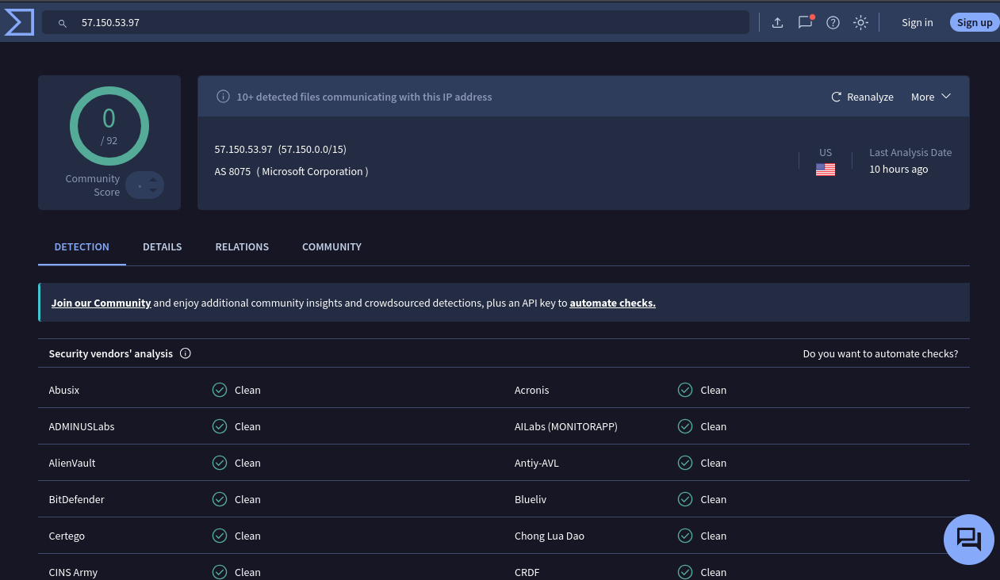

### 6.2 holtandberyl[.]com

About 97 seconds before the download, the host looked up holtandberyl[.]com (answer 35.170.55[.]9) and sent two HTTP requests, `/prw` and `/crv`. Both replies are 178-byte `301 Moved Permanently` pages from nginx/1.24.0 (Ubuntu). The `Location` headers (frames 8238 and 8347) point to `https://holtandberyl.com/prw` and `https://holtandberyl.com/crv`, so each is a plain HTTP to HTTPS upgrade on the same host. The host then opened two TLS sessions to 35.170.55[.]9:443, one right after each request. The first was 96 frames (80 kB) over 0.47 s. The second was 1,230 frames (1,167 kB, with 815 frames and 1,142 kB toward the victim) over 1.85 s. The content is encrypted, so I can't say what the larger transfer was, and I'm drawing no conclusion about this host.

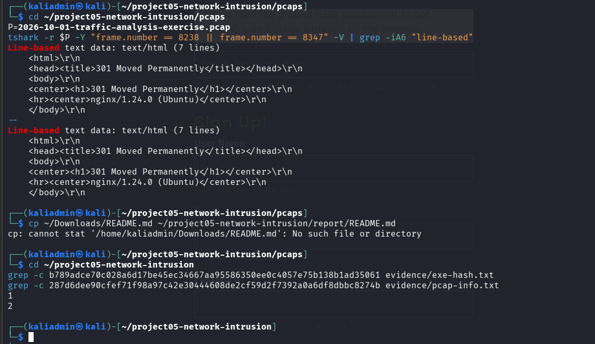
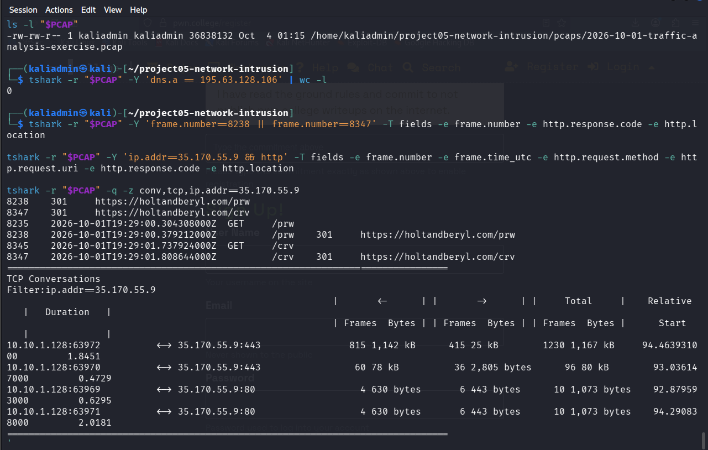

### 6.3 Connections to the domain controller at 19:32

Between 19:32:15 and 19:33:00 the victim and the domain controller exchanged 168 frames (51,700 bytes): 18 DNS, 42 LDAP, 2 Kerberos, 22 DCE/RPC (4 endpoint mapper and 12 `drsuapi`), and 2 other TCP data frames. The victim opened nine TCP connections to the DC in that window:

| Time (UTC) | Destination port | Service |
|---|---|---|
| 19:32:20.639 | 389 | LDAP |
| 19:32:20.642 | 88 | Kerberos (the TGS-REP in frame 40417 is on this connection) |
| 19:32:20.668 | 389 | LDAP |
| 19:32:39.482 | 135 | RPC endpoint mapper |
| 19:32:39.487 | 49669 | RPC on a high port |
| 19:32:39.501 and 19:32:39.510 | 389 | LDAP |
| 19:32:48.096 and 19:32:48.116 | 389 | LDAP |

The 12 `drsuapi` frames (40467 to 40480, all within about 6 ms) are 6 calls, each counted as request and response. They run twice as Bind (opnum 0), CrackNames (opnum 12) and Unbind (opnum 1). There is no `DRSGetNCChanges` (opnum 3), the replication call that DCSync uses, so nothing in this window looks like replication. LDAP, Kerberos and name lookups are routine for a domain member, and the capture doesn't show what triggered them. I only examined 19:32:15 to 19:33:00, so later traffic to the DC is not analysed.

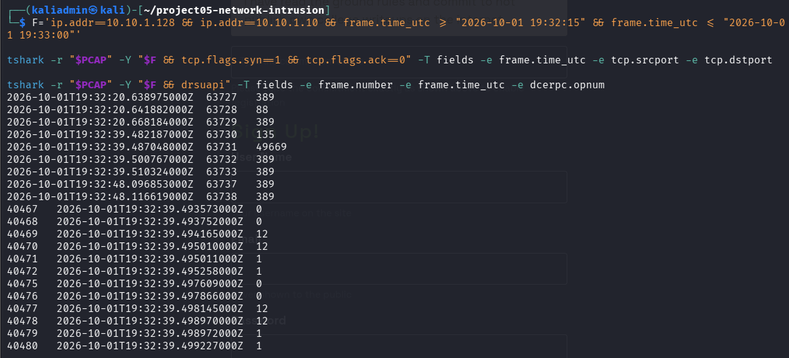
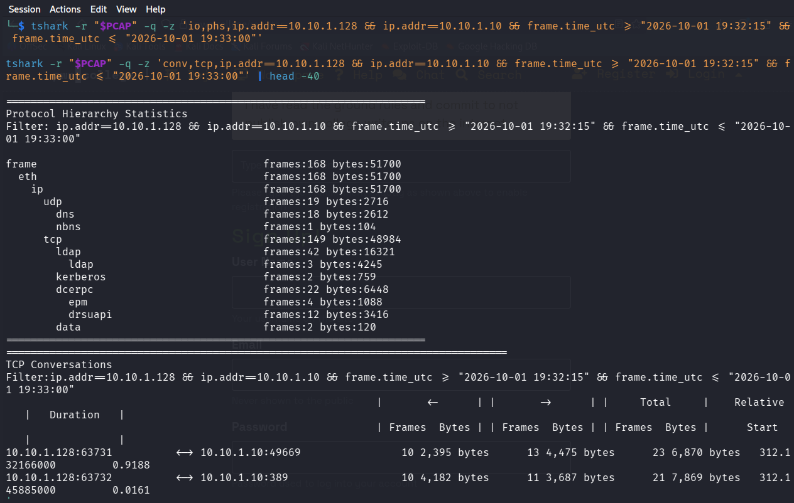

---

## 7. Discrepancy in the supplied indicators

The alert lists `195.64.128[.]106`, and a filter for that address matches zero packets. The only address in that range the victim contacted is `195.63.128[.]106`. It differs by one digit and has a poor reputation (section 9). The alert may simply contain a typo, but I can't confirm that from the capture. I treat 195.63.128[.]106 as the address that was actually contacted, and I don't assume it is the "CNCmachineRMS" server the alert names.

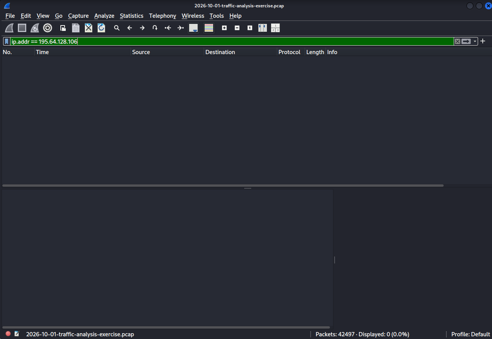

---

## 8. Indicators of compromise

| Type | Value | Note |
|---|---|---|
| URL | `hxxp://107.175.82[.]242:9000/wilow/runner_ilove[.]exe` | Request in frame 23091 |
| IP:port | 107.175.82[.]242:9000 | Served the executable (MinIO server header) |
| File name | `runner_ilove.exe` | VirusTotal also records `service.exe` as the PE original name |
| SHA-256 | `b789adce70c028a6d17be45ec34667aa95586350ee0c4057e75b138b1ad35061` | |
| MD5 | `cb50fe432a302b85845bc7ea98742c11` | Matches the server ETag |
| Size | 1,646,592 bytes | |
| User-Agent | `curl/8.21.0` | |
| IP:port | 195.63.128[.]106:443 | Long session, 15,595 packets |
| IP | 195.64.128[.]106 | Listed in the alert; not present in the capture |

There's a machine-readable version in [`evidence/iocs.csv`](../evidence/iocs.csv).

---

## 9. Threat intelligence enrichment

I looked these up in late October 2026. They're point-in-time results from outside the capture.

For the executable (`b789adce...`):

- 45 of 70 engines flag it as malicious. The most common labels are CapDoor and Zusy, and at least one vendor says AsyncRAT. The family isn't settled.
- It isn't signed. Version information reads "Diagnostics Service" and the PE original name is `service.exe`.
- The PE creation time is 2059-01-16, which is invalid and no use to me.
- First submission was 2026-10-04 and first seen in the wild 2026-10-08, both after the capture date.
- Sandbox runs recorded no network communication. The tags include `detect-debug-environment`, `long-sleeps` and `idle`. VirusTotal lists only assets.adobedtm[.]com and dns[.]google as contacted domains.

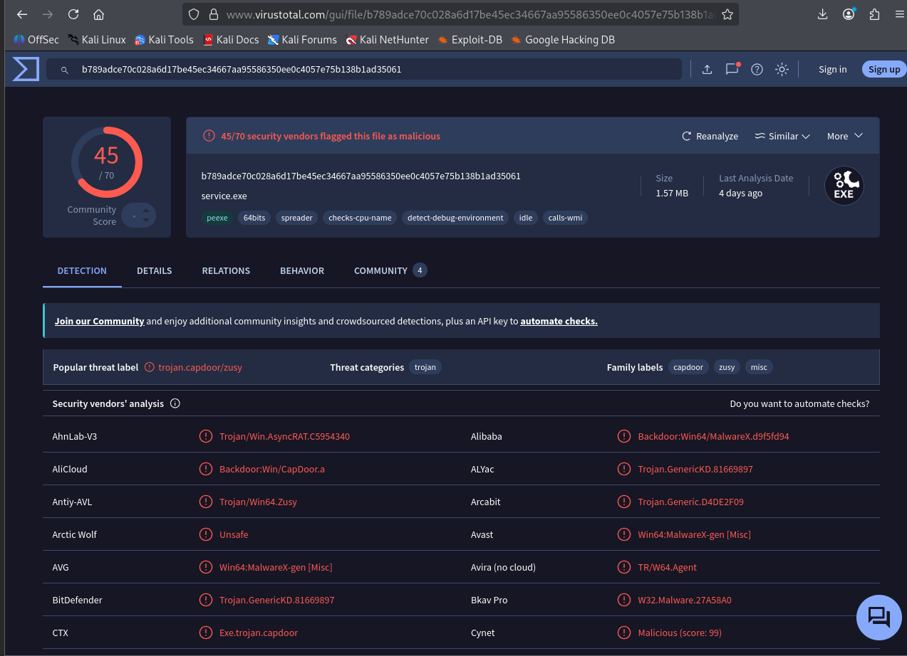
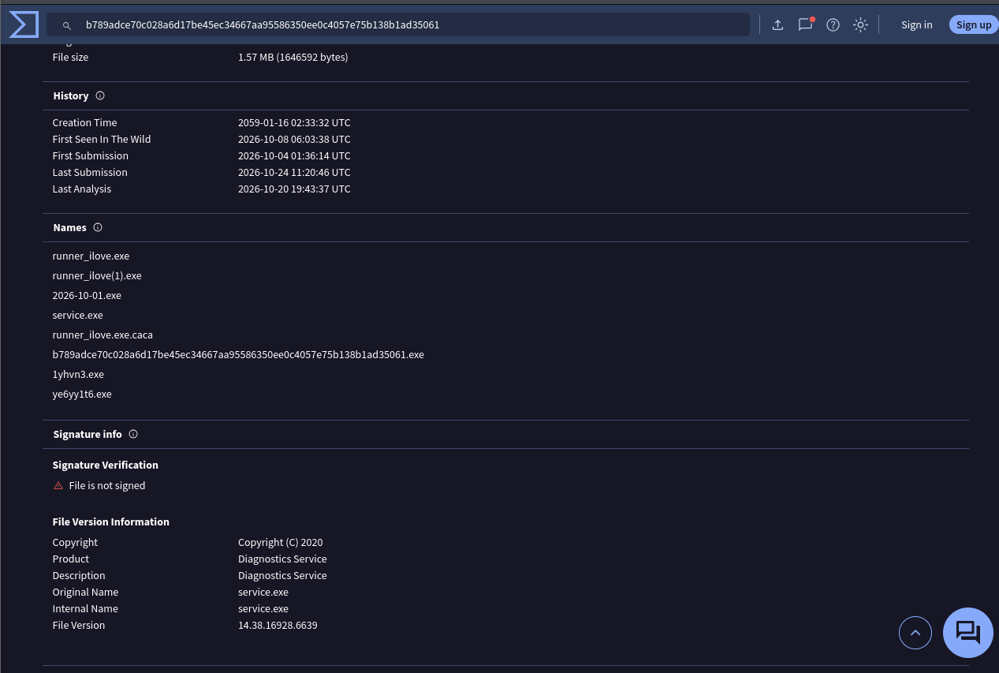
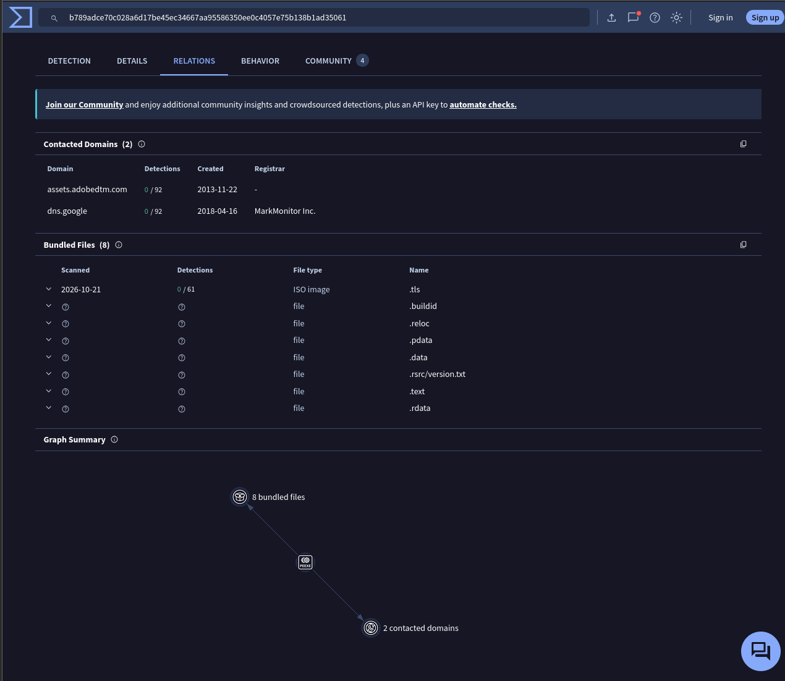
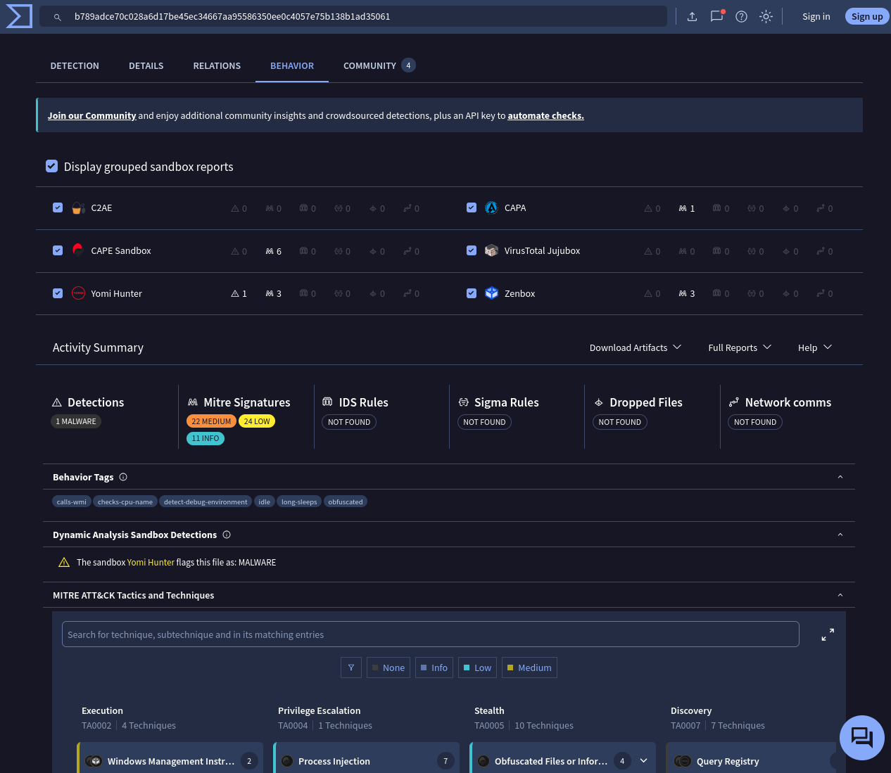

For 195.63.128[.]106 (contacted in the capture):

- 7 of 92 vendors flag it as malicious and one as suspicious. It sits in AS216071 (Servers Tech Fzco), Netherlands, with a community score of -12.
- Passive DNS lists lapiscorbel[.]info (resolved 2026-09-25, 8/92), v1019443.hosted-by-vdsina[.]com (2026-09-29, 1/92) and rollup[.]capital (2023-07-10, 0/92). A shared hosting address doesn't prove those domains were involved here, and none of them appear in this capture.
- VirusTotal has no recorded link between this address and the executable's hash.

For 195.64.128[.]106 (listed in the alert): 0 of 92, Switzerland.

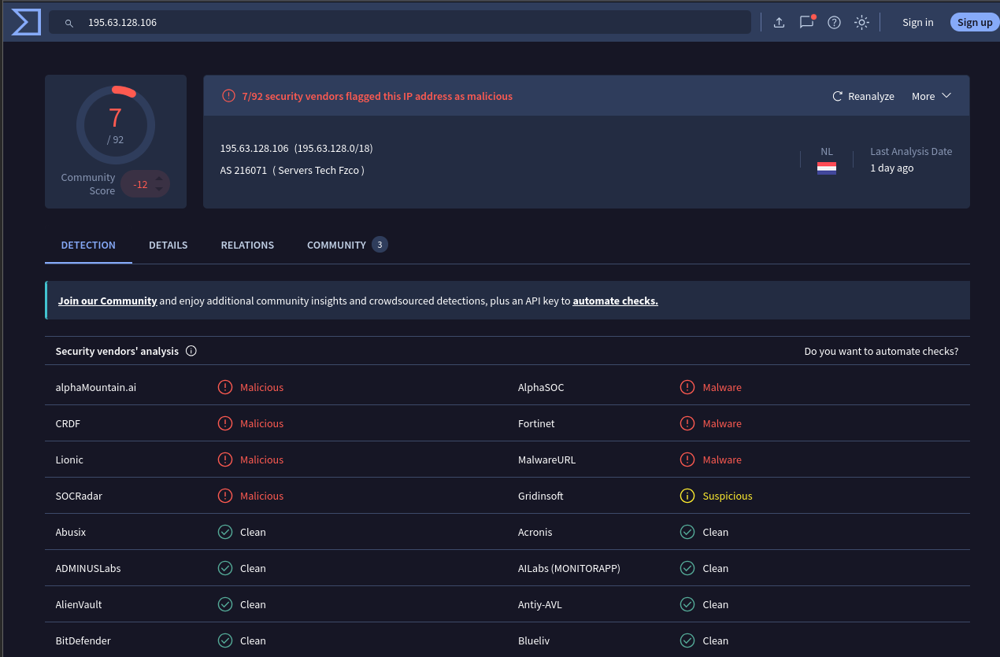
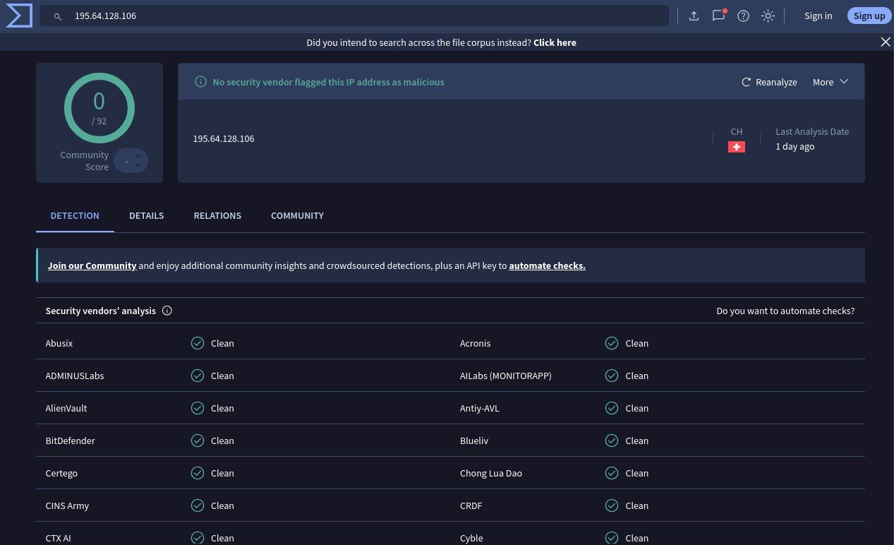
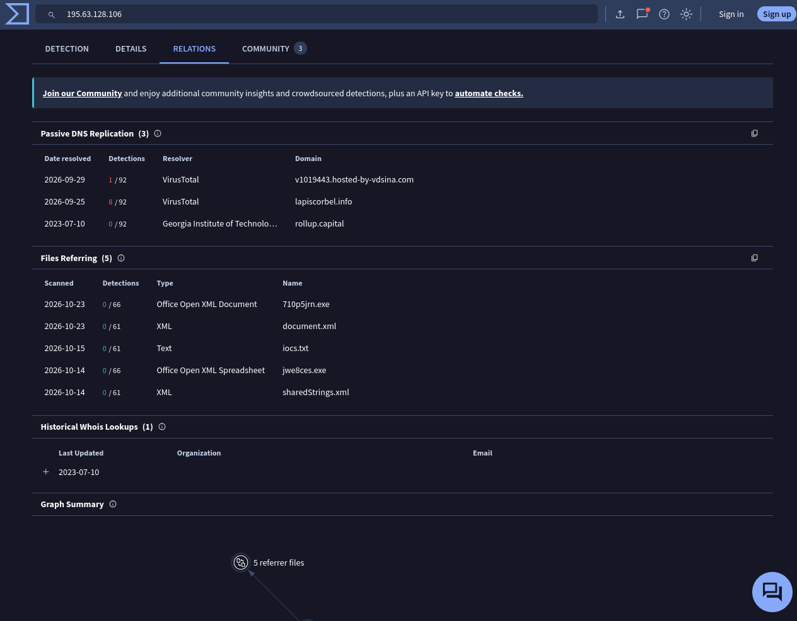

---

## 10. MITRE ATT&CK mapping (only what the capture shows)

| Technique | Evidence |
|---|---|
| T1105 Ingress Tool Transfer | Executable downloaded with curl, frames 23091 to 24916 |
| T1571 Non-Standard Port | HTTP served on TCP 9000 |

I left the non-TLS session on port 443 unmapped, because the candidate techniques depend on what the payload holds and the capture doesn't show that. I also left out techniques that appear only in VirusTotal sandbox reports (WMI use and process injection, for example), since I didn't observe them in this capture.

---

## 11. Limitations and open items

- The capture has no endpoint data, so I don't know what the executable did on the host or which process made each connection.
- I can't read the content of stream 130, so its purpose (another download, remote control or something else) is unconfirmed.
- The two `301` replies from holtandberyl[.]com redirect to the same paths over HTTPS. The TLS sessions that follow to 35.170.55[.]9 are encrypted, so I can't say what the larger one (about 1.1 MB toward the victim) carried.
- No DNS answer in the capture resolves to 195.63.128[.]106 (`dns.a == 195.63.128.106` matched 0 packets). The address could have come from the encrypted lookup to dns.google or been hard-coded, and the capture can't tell which.
- The connections to the domain controller at 19:32 (section 6.3) look like routine domain activity and include no replication calls. I only examined 19:32:15 to 19:33:00, so later traffic to the DC is not analysed.
- Threat-intel results change over time.
- [`scripts/reproduce_metrics.sh`](../scripts/reproduce_metrics.sh) regenerates the measured values in this report from the pcap.

---

## 12. Recommendations

If this were a live incident, I would:

- Isolate DESKTOP-4VGYQX7 and acquire memory and disk, since the pcap can't show host behaviour.
- Block 107.175.82[.]242 and 195.63.128[.]106 at egress, and search firewall, proxy and DNS logs for other hosts that contacted them.
- Review recent authentication for `bdiaz` and reset the credentials.

For detection, I'd look at:

- An HTTP request for an `.exe` with a `curl` User-Agent from a workstation subnet to an external address, especially on a non-standard port. Draft rules for this are in [`detections/`](../detections/).
- Outbound TCP 443 where the first client payload isn't a TLS record.
- A single long-lived external session with very lopsided inbound volume.
- TLS to public DNS-over-HTTPS resolvers from hosts where that isn't expected.

For prevention, egress allow-listing of ports, and application control against unsigned executables from user-writable paths.
